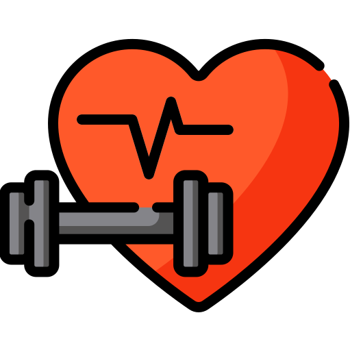
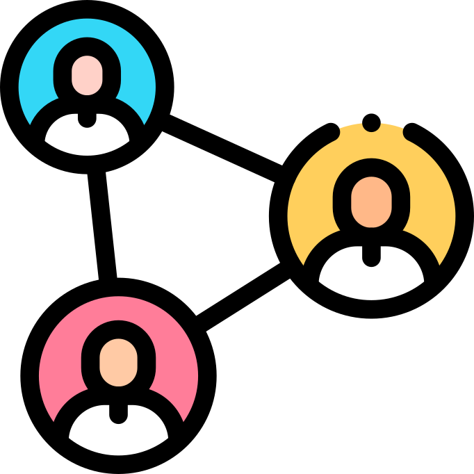

# Diese Heuristiken schlagen wir vor 

    
Fitness Functions + Evolutionäre Architektur
 <!-- .element: class="fragment bigger" -->
    
Rollenmodelle für Architekturarbeit
 <!-- .element: class="fragment bigger" -->
    
Prototyp vs. Walking Skeleton vs. MVP
 <!-- .element: class="fragment bigger" -->
    
Kollaborative Architekturarbeit
 <!-- .element: class="fragment bigger" -->
    
Letzter vernünftiger Moment
 <!-- .element: class="fragment bigger" -->
    
Modularisierung
 <!-- .element: class="fragment bigger" -->

