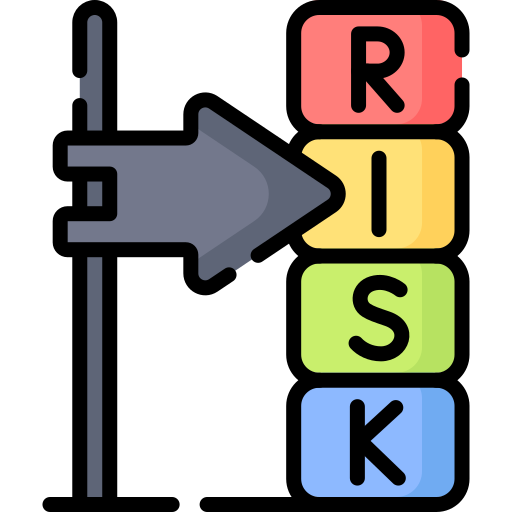
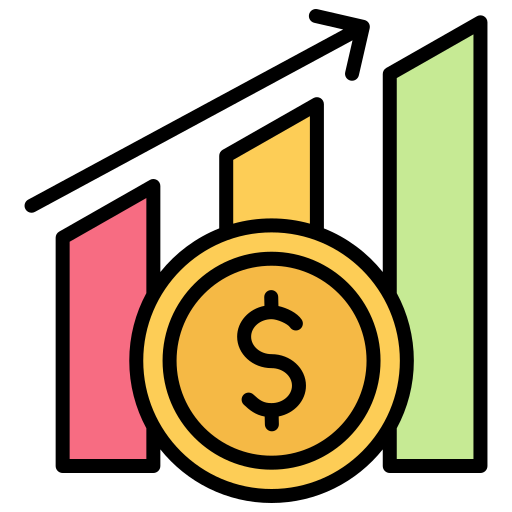

# Fazit: Wie begegnen wir dem Mythos?

Voreilige Entscheidungen vermeiden
 <!-- .element: class="bigger" -->

Lernfenster & "Letzter vernünftiger Moment"
 <!-- .element: class="bigger" -->

Einzelverantwortung vs. kollaborative Architekturarbeit
 <!-- .element: class="bigger" -->

Entscheidungsgrundlagen und Alternativen dokumentieren
 <!-- .element: class="bigger" -->

