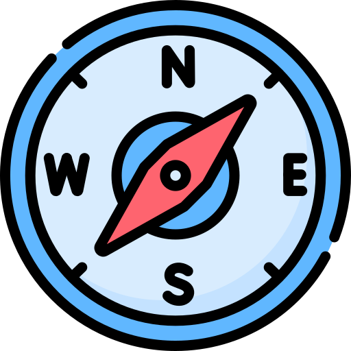

# Was ist das Problem?
<!-- .slide: data-background="#660000" -->

 Fehlende technische Ausrichtung / langfristige Perspektive
 <!-- .element: class="fragment bigger" -->

 Inkonsistente Entscheidungen
 <!-- .element: class="fragment bigger" -->

 Zufällige Architektur
 <!-- .element: class="fragment bigger" -->

 Koordinationsprobleme zwischen Teams
 <!-- .element: class="fragment bigger" -->

 Fehlende Qualitätskriterien & Leitplanken
 <!-- .element: class="fragment bigger" -->

Note:
1) Fehlende technische Ausrichtung

Agile Teams liefern schnell Mehrwert, aber ohne technische Orientierung entstehen leicht lokale Optimierungen, die systemweit zu Inkonsistenzen führen. Ohne gemeinsam verstandene Architekturziele droht ein „Wir machen’s so, wie es gerade passt“ – und das skaliert schlecht.
Agile Teams fokussieren stark auf kurzfristigen Mehrwert, was wertvoll ist – aber ohne jemanden, der bewusst auf zukünftige Auswirkungen achtet, drohen technische Schulden. Architektur braucht sowohl Gegenwart als auch Zukunft im Blick.

2) Inkonsistente Entscheidungen

Ohne Rolle oder Funktion, die Entscheidungen moderiert und zusammenführt, treffen Teams unterschiedliche technische Entscheidungen für ähnliche Probleme. Das erschwert Integration, erhöht Komplexität und führt zu unnötigem Wildwuchs.

3) Architektur entsteht zufällig

Wenn niemand explizit für Struktur und langfristige Kohärenz sorgt, entsteht Architektur trotzdem – aber ungeplant und inkrementell verzogen. Das Ergebnis sind fragile Systeme, die schwer verständlich und teuer zu ändern sind.

4) Koordinationsprobleme zwischen Teams

In skalierten Umgebungen entstehen Abhängigkeiten zwischen Teams. Ohne jemanden, der diese technischen Schnittstellen moderiert, kommt es schnell zu Konflikten und Verzögerungen. Architektur ist ein sozio-technisches Koordinationsinstrument.

5) Fehlende Qualitätskriterien & Leitplanken

Teams arbeiten agil, aber ohne definierte Qualitätsziele wie Robustheit, Wartbarkeit oder Performance optimiert jedes Team anders. Architektur schafft gemeinsame Leitplanken, die das System langfristig tragfähig halten.
