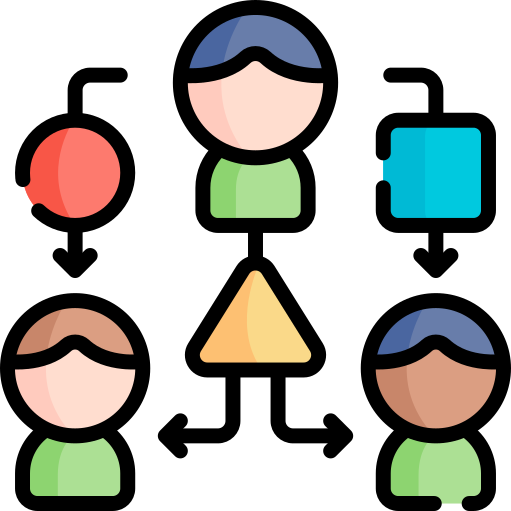

# Wie begegnen wir dem Mythos? 

 Architektur als Teamaufgabe
 <!-- .element: class="fragment bigger" -->

 Moderation statt Vorgaben
 <!-- .element: class="fragment bigger" -->

 Gemeinsame Architekturprinzipien
 <!-- .element: class="fragment bigger" -->

 Transparenz
 <!-- .element: class="fragment bigger" -->

 Evolutionäre Architektur fördern
 <!-- .element: class="fragment bigger" -->

Note:

✅ Lösungsansätze („Wie begegnen wir dem Mythos?“)

1) Architektur als Teamaufgabe etablieren

Architekturarbeit sollte nicht isoliert passieren, sondern gemeinsam mit dem Team. Eine einzelne Person hat nicht die ganze Wahrheit, aber jemand muss den Prozess moderieren. So entsteht nicht weniger, sondern bessere Architektur — weil mehr Perspektiven einfließen.

2) Entscheidungsmoderation statt Vorgaben

Moderne Architekt:innen diktieren nicht, sie facilitieren: Sie stellen Fragen, schaffen Klarheit, formulieren Leitplanken und unterstützen Teams bei schwierigen Entscheidungen. So entsteht Alignment ohne Hierarchie.

3) Gemeinsame Architekturprinzipien definieren

Ein leichtgewichtiges Set an Regeln (z. B. Kopplung minimieren, klare Schnittstellen, Domain-Boundaries respektieren) schafft Orientierung. Diese Prinzipien sind der Rahmen, in dem Teams autonom handeln können — ohne dass Chaos entsteht.

4) Transparente Entscheidungen (ADRs) einführen

Architecture Decision Records machen sichtbar, warum etwas entschieden wurde und welche Alternativen es gab. Damit werden Entscheidungen nachvollziehbar und konsistent — und spätere Diskussionen deutlich einfacher.

5) Regelmäßiges technisches Alignment ermöglichen

Kurze gemeinsame Architektur-Reviews, Architektur-Boards oder Brown Bags helfen Teams, voneinander zu lernen und Konflikte früh zu erkennen. Diese Foren sollten leichtgewichtig und kollaborativ sein, nicht bürokratisch.

6) Evolutionäre Architektur fördern

Architektur soll sich anpassen dürfen. Mit kleinen Schritten, klaren Leitplanken und Feedback-Schleifen entwickeln Teams stabile Strukturen, die gleichzeitig veränderbar bleiben. Das reduziert das Risiko großer Fehlentscheidungen und stärkt die Teamautonomie.
