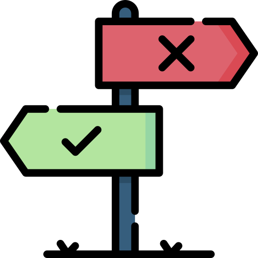

# Sichtbar machen von ...

 Architekturkonzepten
 <!-- .element: class="fragment bigger" -->

 Architekturentscheidungen
 <!-- .element: class="fragment bigger" -->

 Rollen von Bausteinen (DTO, ...) und Verortung
 <!-- .element: class="fragment bigger" -->

 fachliche & technische Modulstrukturen
 <!-- .element: class="fragment bigger" -->
