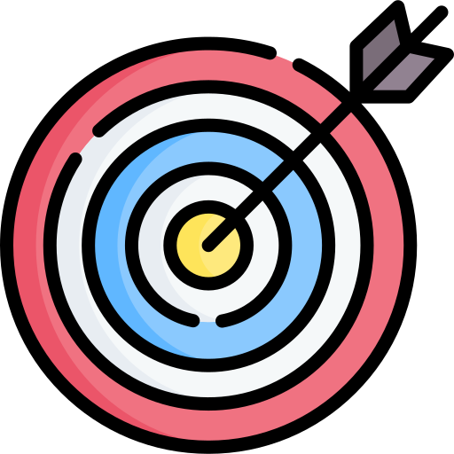
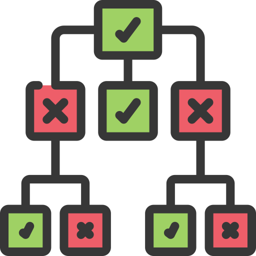
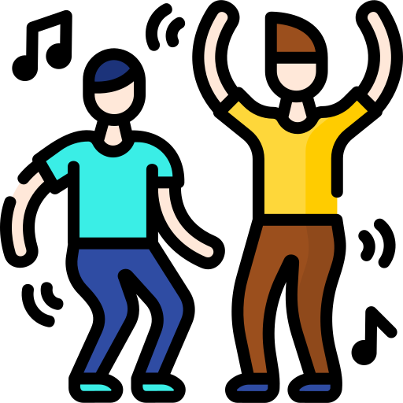

# Wie begegnen wir dem Mythos? 

 Zielgerichtete Dokumentation

 <!-- .element: class="fragment bigger" -->

 Leichtgewichtig, Docs-as-Code
 <!-- .element: class="fragment bigger" -->

 Transparente Architekturentscheidungen
 <!-- .element: class="fragment bigger" -->

 
Continuous Documentation
 <!-- .element: class="fragment bigger" -->

 Lebendige Dokumentation
 <!-- .element: class="fragment bigger" -->
